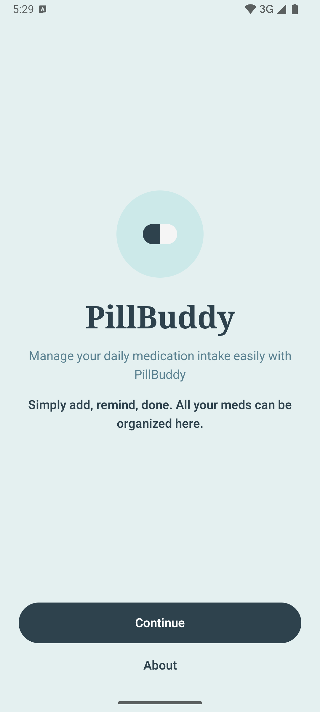
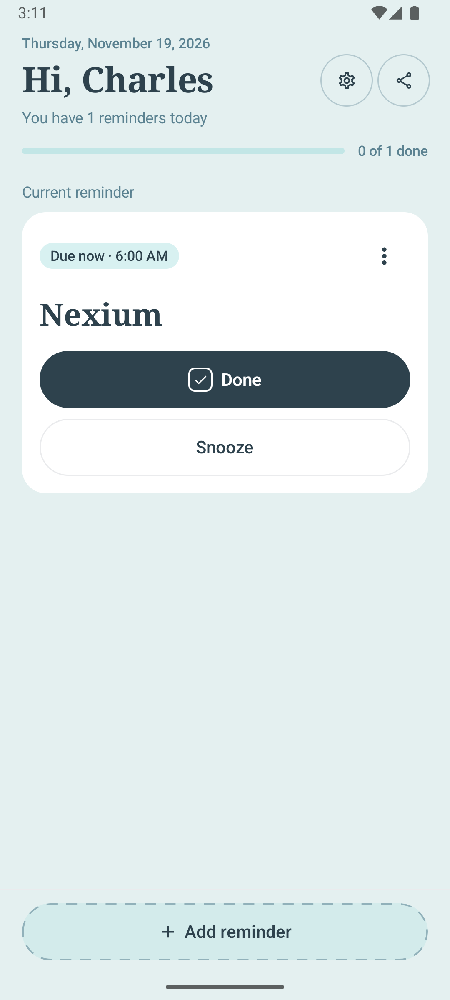
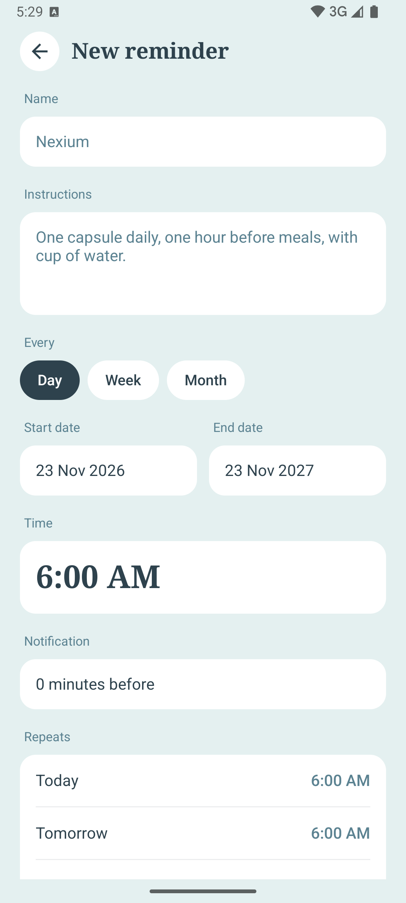
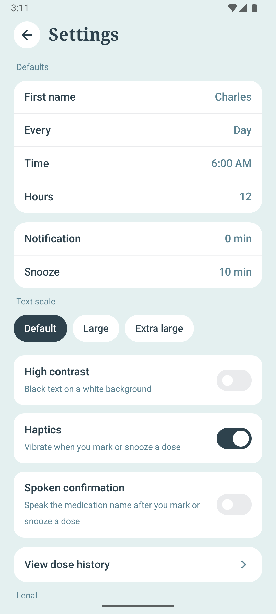
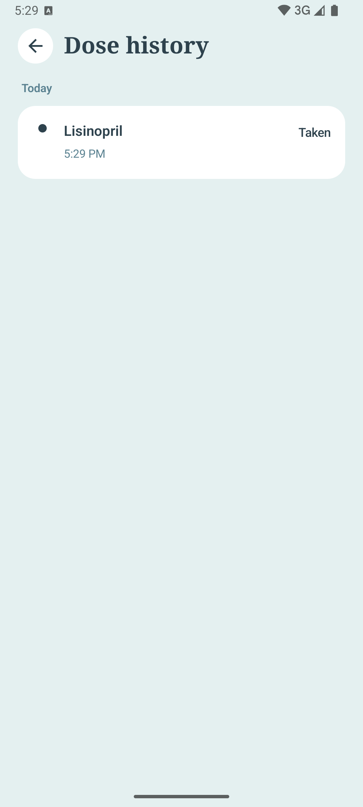

# PillBuddy

PillBuddy is an Android medication reminder app. Add your meds, get notified when a dose is due, mark it done or snooze it, and keep today’s schedule on one screen. All reminder and history data stays on the device.

## Screenshots

| Onboarding | Home |
| --- | --- |
|  |  |  |  |
|  |

## How it works

1. **Onboarding** — First launch introduces the app. Continue once to open Home.
2. **Home** — Shows today’s doses, progress (done / total), the current due card, and missed or upcoming items. Mark **Done** or **Snooze**, edit or delete from the card menu, share today’s summary, or open Settings.
3. **Add / edit reminder** — Enter medication name and optional instructions, choose Day / Week / Month, start and end dates, dose time, and how early to notify. A repeats preview lists the next scheduled times. Saving stores the reminder and schedules exact alarms.
4. **Notifications** — Exact alarms fire dose alerts. Actions on the notification (done / snooze) update history. Alarms are rescheduled after boot, timezone changes, and app updates.
5. **Settings** — Profile name, default schedule values, snooze length, text scale, high contrast, haptics, and spoken confirmation. Links to dose history plus privacy policy and disclaimer.
6. **Dose history** — Lists doses you marked as taken (and related history) for review.

```text
Onboarding → Home ⇄ New / Edit reminder
                ⇄ Settings → Dose history
                           → Privacy / Disclaimer (web)
```

## Tech stack

| Layer | Choice |
| --- | --- |
| Language | Kotlin |
| UI | Jetpack Compose + Material 3 |
| Architecture | Single-activity app, ViewModels, manual `AppContainer` DI |
| Local DB | SQLDelight (reminders + dose events) |
| Preferences | Jetpack DataStore |
| Scheduling | `AlarmManager` exact alarms + `BroadcastReceiver` (boot / package replaced) |
| Notifications | Notification channels with Done / Snooze actions |
| Min / target SDK | 24 / 35 (compile SDK 36) |
| Build | Android Gradle Plugin 8.9, Kotlin 2.0, Compose BOM 2024.09 |

## Legal

Hosted on Netlify:

- [Privacy policy](https://pillbuddy-legal.netlify.app/privacy)
- [Disclaimer](https://pillbuddy-legal.netlify.app/disclaimer)

Source HTML lives in [`docs/`](docs/).

## Build

Open the project in Android Studio, or from the repo root:

```bash
./gradlew :app:assembleDebug
```

Install on a device or emulator:

```bash
./gradlew :app:installDebug
```
